# AI 选品 V1 当前开发链路

本文说明当前算法卡调整后的真实开发链路。开发评审以本文、`02_data_contracts/` 和 01～06 开发版算法卡为准。

开发第一步不是直接写算法 01。第一批开发必须先完成基础数据表整理和公共交易过滤逻辑，再进入算法 01～03。

## 1. 当前算法状态

| 范围 | 名称 | 当前状态 | 本次评审建议 |
|---|---|---|---|
| 基础数据 | 数据合同和基础表整理 | 已整理数据合同 | P0，本次最先评审 |
| 公共逻辑 | 有效交易过滤和公共维表关联 | 待数据开发按合同落地 | P0，本次最先评审 |
| 01 | 会员画像 | 已整理为开发版算法卡 | P0，本次重点评审 |
| 02 | 门店品类等级 | 已整理为开发版算法卡 | P0，本次重点评审 |
| 03 | 门店群消费者画像贡献 | 已整理为开发版算法卡 | P0，本次重点评审 |
| 04 | 目标画像 SKU 表现 | 已整理为开发版算法卡 | P1，先阅读，下一轮重点评审 |
| 05 | 目标画像商品价格带 | 已整理为开发版算法卡 | P1，先阅读，依赖 04 和候选成本配置 |
| 06 | 目标画像购物篮新品关联 | 已整理为开发版算法卡 | P1，先阅读，依赖 04/05 和规则资产评审 |
| 07 | 竞品与全球外部趋势新品发现 | 更新中 | 不进入本次开发评审 |
| 08 | 新品机会证据合成与风险门禁 | 更新中 | 不进入本次开发评审 |
| 09 | 新品候选标准化与合并 | 更新中 | 不进入本次开发评审 |
| 10 | 新品推荐优先级与开发需求编排 | 更新中 | 不进入本次开发评审 |

## 2. 当前开发总链路

这张图只表达开发顺序和上游依赖，不展开每张基础表到每个算法的所有字段关联。基础表字段级输入看 `02_data_contracts/`，算法字段级输入看各算法开发版算法卡。

如果要看离线产表和在线查询的运行顺序，先看：

```text
05_architecture/AI选品V1_运行时序图.md
```

如果要看后端 API、Agent Harness、大模型解释和反馈日志的运行边界，先看：

```text
05_architecture/runtime_design/AI新品推荐Agent_运行架构图.md
```



```mermaid
flowchart LR
    CONTRACT["第0步：基础数据合同<br/>02_data_contracts/"]
    BASE["基础数据表整理<br/>Doris小票 / 商品 / 门店 / 城市区域<br/>毛利损耗 / 日价格 / 可订可售"]
    FILTER["公共交易过滤和维表关联<br/>有效交易 / 商品关联 / 门店关联 / 城市区域"]

    subgraph P0["本次 P0：先让开发开工"]
        A01["01 会员画像<br/>dim_customer_profile"]
        A02["02 门店品类等级<br/>mart_store_category_level"]
        A03["03 画像贡献<br/>mart_store_group_consumer_contribution"]
    end

    subgraph P1["下一轮 P1：读链路，后续评审"]
        A04["04 目标画像 SKU 表现"]
        A05["05 目标画像商品价格带"]
        A06["06 购物篮新品关联"]
    end

    subgraph UPD["更新中"]
        A07["07 外部竞品趋势"]
        A08["08 证据合成与风险门禁"]
        A09["09 新品候选标准化"]
        A10["10 推荐优先级编排"]
    end

    OUT["后续推荐与 Agent 查询<br/>结果表 / 接口 / 解释"]

    CONTRACT --> BASE
    BASE --> FILTER
    FILTER --> A01
    FILTER --> A02
    A01 --> A03
    A02 --> A03
    A03 --> A04
    A04 --> A05
    A04 --> A06
    A05 --> A06
    A06 --> A07
    A07 --> A08
    A08 --> A09
    A09 --> A10
    A10 --> OUT
```

## 3. 本次建议开发主线

本次先把基础数据表整理、公共过滤逻辑和 01～03 当成第一批开发主线：

```text
基础数据合同确认
-> 基础数据表整理和字段映射
-> 有效交易过滤公共逻辑
-> 算法 01 会员画像
-> 算法 02 门店品类等级
-> 算法 03 门店群消费者画像贡献
```

原因：

| 主线 | 为什么先做 |
|---|---|
| 基础数据合同 | 后续所有算法都依赖小票、商品、门店、城市区域和经营数据 |
| 基础数据表整理 | 先把 `dim_store`、`dim_sku`、城市区域、毛利损耗、日价格、可订可售等表按合同产出，算法才能稳定取数 |
| 公共交易过滤 | 统一有效交易、退货退款、负金额、负 `weight` 等处理，避免 01～06 各算各的 |
| 算法 01 | 给会员打 `final_profile`，是 03、04、05 的上游 |
| 算法 02 | 给门店品类打 `final_level`，是 03、04、05 的上游 |
| 算法 03 | 把 01 和 02 连接起来，形成目标画像和门店群贡献 |

## 4. 04～06 怎么进入下一轮

算法 04～06 已有开发版算法卡，但建议作为第二轮评审重点。

| 算法 | 下一轮重点 |
|---|---|
| 04 | 复购前置表、目标画像 SKU 毛利、SKU/SPU 聚合、锚点输出 |
| 05 | 价格带、候选成本估算、公司毛利底线和价格阶梯配置 |
| 06 | 购物篮规则、小分类新品属性规则、季节商品状态、候选生成状态 |

## 5. 开发要去哪里看

| 开发要做什么 | 先看哪个文件 / 目录 | 交付物 |
|---|---|---|
| 确认 Doris 小票字段 | `02_data_contracts/doris_tables/` | 小票字段口径、有效交易过滤口径 |
| 准备门店基础表 | `02_data_contracts/base_tables/dim_store_门店基础表.md` | `dim_store` |
| 准备商品基础表 | `02_data_contracts/base_tables/dim_sku_商品基础表.md` | `dim_sku` |
| 准备城市算法区域映射 | `02_data_contracts/base_tables/dim_city_algorithm_region_城市算法区域映射表.md` | `dim_city_algorithm_region` |
| 准备毛利损耗表 | `02_data_contracts/base_tables/mart_sku_margin_loss_毛利损耗表.md` | `mart_sku_margin_loss` |
| 准备门店商品日价格表 | `02_data_contracts/base_tables/mart_store_sku_daily_price_门店商品日价格表.md` | `mart_store_sku_daily_price` |
| 准备可订可售表 | `02_data_contracts/base_tables/mart_store_sku_daily_sale_order_status_门店商品每日可订可售表.md` | `mart_store_sku_daily_sale_order_status` |
| 开发算法 01 | `03_algorithm_cards/developer_version/算法卡_01_会员画像.md` | 会员画像正式表、解释表、参数表、汇总表 |
| 开发算法 02 | `03_algorithm_cards/developer_version/算法卡_02_门店品类等级.md` | 门店品类等级正式表和参数/解释表 |
| 开发算法 03 | `03_algorithm_cards/developer_version/算法卡_03_门店群消费者画像贡献.md` | 画像贡献正式表和汇总表 |
