# AI 选品 V1 当前开发链路

本文说明当前算法卡调整后的真实开发链路。算法 01～10 已整理为开发版算法卡；开发评审按完整 V1 规格看，实际建设可按依赖分阶段实施。

开发第一步不是直接写算法 01。必须先完成基础数据表、外部表、规则表、公共交易过滤和版本血缘设计，再进入算法结果表建设。

## 1. 当前算法状态

| 范围 | 名称 | 当前状态 | 开发评审建议 |
|---|---|---|---|
| 基础数据 | 数据合同和基础表整理 | 已整理数据合同 | P0，最先评审和建设 |
| 外部数据 | 久谦原始表、竞品 SKU、竞品每日快照 | 已整理数据合同 | P0，涉及算法 05、07、09、10 时必须评审 |
| 规则配置 | 毛利、价格点、购物篮、命名、属性、合规、法规等规则表 | 已整理数据合同和标准 Excel 提供清单 | P0，优先确认标准 CSV 落 Doris 方式 |
| 公共逻辑 | 有效交易过滤和公共维表关联 | 待数据开发按合同落地 | P0，所有交易算法共用 |
| 01 | 会员画像 | 已整理为开发版算法卡 | P1，基础表满足后建设 |
| 02 | 门店品类等级 | 已整理为开发版算法卡 | P1，可与 01 并行建设 |
| 03 | 门店群消费者画像贡献 | 已整理为开发版算法卡 | P1，读取 01 和 02 |
| 04 | 目标画像 SKU 表现 | 已整理为开发版算法卡 | P2，读取 01～03 和经营基础表 |
| 05 | 目标画像商品价格带 | 已整理为开发版算法卡 | P2，内部价格带和价格可行性先建设；竞对价格验证等 07 后补齐 |
| 06 | 目标画像购物篮新品关联 | 已整理为开发版算法卡 | P2，读取 04、05、购物篮规则和商品状态 |
| 07 | 竞品与全球外部趋势新品发现 | 已整理为开发版算法卡 | P3，读取外部竞品、规则表和内部适配结果 |
| 08 | 新品候选标准化与合并 | 已整理为开发版算法卡 | P4，读取 04/05/06/07 候选和证据 |
| 09 | 新品机会证据合成与风险门禁 | 已整理为开发版算法卡 | P4，读取 08 标准候选和上游证据 |
| 10 | 新品推荐优先级与开发需求编排 | 已整理为开发版算法卡 | P5，读取 09 通过或条件通过结果，输出推荐展示和解释 |
| 联调 | 后端 API、Agent Harness、前端展示和反馈 | 架构已整理 | P6，读取算法 10 结果表，不实时重算算法 |

## 2. 当前开发总链路

这张图只表达开发顺序和上游依赖，不展开每张基础表到每个算法的所有字段关联。基础表字段级输入看 `02_data_contracts/`，算法字段级输入看各算法开发版算法卡。

```mermaid
flowchart LR
    CONTRACT["第0步：数据合同<br/>02_data_contracts/"]
    BASE["基础数据表 / 外部表 / 规则表<br/>Doris小票 / 商品 / 门店 / 商品状态 / 竞品 / 规则配置"]
    FILTER["公共交易过滤和维表关联<br/>有效交易 / 商品关联 / 门店关联 / 城市区域 / 版本血缘"]

    A01["01 会员画像<br/>dim_customer_profile"]
    A02["02 门店品类等级<br/>mart_store_category_level"]
    A03["03 画像贡献<br/>mart_store_group_consumer_contribution"]
    A04["04 SKU 表现<br/>锚点和现有商品证据"]
    A05["05 商品价格带<br/>内部价格带 / 候选价格可行性 / 竞对价格验证"]
    A06["06 购物篮新品关联<br/>内部场景和属性候选"]
    A07["07 外部竞品趋势<br/>外部候选 / 竞对 / 图片 / 风险线索"]
    A08["08 候选标准化与合并<br/>标准候选 / 范围候选 / 09 快照"]
    A09["09 证据合成与风险门禁<br/>PASS / CONDITIONAL_PASS / REJECT"]
    A10["10 推荐优先级与展示<br/>mart_new_product_recommendation_priority"]
    API["后端 API / Agent / 前端<br/>列表 / 详情 / 解释 / 反馈"]

    CONTRACT --> BASE
    BASE --> FILTER
    FILTER --> A01
    FILTER --> A02
    A01 --> A03
    A02 --> A03
    A03 --> A04
    A04 --> A05
    A04 --> A06
    A04 --> A07
    A06 --> A07
    A07 --> A05
    A04 --> A08
    A05 --> A08
    A06 --> A08
    A07 --> A08
    A08 --> A09
    A09 --> A10
    A10 --> API
```



## 3. 分阶段开发主线

建议按下面顺序拆任务：

```text
P0：基础数据表、外部表、规则表、公共过滤、版本血缘
P1：算法 01、02、03
P2：算法 04、算法 05 内部价格带和价格可行性、算法 06
P3：算法 07、算法 05 竞对价格验证
P4：算法 08、算法 09
P5：算法 10
P6：后端 API、Agent Harness、前端展示和反馈联调
```

原因：

| 主线 | 为什么这样排 |
|---|---|
| P0 | 后续所有算法都依赖小票、商品、门店、城市区域、经营数据、竞品数据和规则配置 |
| P1 | 01 和 02 可以并行，03 需要读取 01 和 02 |
| P2 | 04 形成现有 SKU 和锚点证据，05 形成国内价格带，06 形成内部购物篮候选 |
| P3 | 07 形成外部候选、竞对和趋势证据，05 的竞对价格验证读取 07 的可比竞对对象后补齐 |
| P4 | 08 负责候选标准化、合并、拆分和快照，09 负责机会证据合成和风险门禁 |
| P5 | 10 只读取 09 已冻结结果，输出推荐展示、排序、解释和摘要 |
| P6 | 后端、Agent 和前端只读正式结果表，不触发离线算法实时重算 |

## 4. 05 和 07 的关系

算法 05 不是单纯“获取竞对商品价格”。它的职责有两层：

1. 先基于内部交易、价格、毛利、价格点规则和候选成本，计算目标画像商品价格带、候选建议价、成本上限和价格可行性。
2. 在算法 07 产出可比竞对对象和外部价格证据后，读取 `fact_competitor_sku_daily_snapshot` 等外部快照，补齐竞对价格验证结果。

因此：

```text
05 内部价格带不依赖 07，可以先产出。
05 竞对价格验证依赖 07，属于 07 完成后的补充验证表。
08 读取 05 的价格可行性、06 的购物篮候选、07 的外部候选和竞对趋势证据。
```

## 5. 开发要去哪里看

| 开发要做什么 | 先看哪个文件 / 目录 | 交付物 |
|---|---|---|
| 确认 Doris 小票字段 | `02_data_contracts/doris_tables/` | 小票字段口径、有效交易过滤口径 |
| 准备内部基础表 | `02_data_contracts/base_tables/` | `dim_store`、`dim_sku`、`dim_product_status`、城市区域、毛利损耗、日价格、可订可售 |
| 准备外部竞品表 | `02_data_contracts/external_data/` | 久谦原始表、竞品 SKU、竞品每日快照 |
| 准备规则配置表 | `02_data_contracts/rule_tables/` | 毛利、价格点、购物篮、命名、属性、合规、法规和复核辅助表 |
| 查看结果表清单 | `00_project_management/development_review/算法01-10_结果表总览.md` | 01～10 结果表和关键表总览 |
| 开发具体算法 | `03_algorithm_cards/developer_version/` | 每个算法的输入、公式、输出字段、状态、调度和验收 |
| 做后端 / Agent 联调 | `03_algorithm_cards/developer_version/算法卡_10_新品推荐优先级与开发需求编排.md` 和 `05_architecture/` | 推荐查询、详情、解释、审计和反馈接口 |

## 6. 在线查询读取什么

后端和 Agent 默认不读取上游 01～09 表直接拼推荐列表。推荐列表以算法 10 表为入口：

| 使用场景 | 读取表 |
|---|---|
| 推荐列表 | `mart_new_product_recommendation_priority` + `new_product_recommendation_display_brief` |
| 推荐详情 | `new_product_recommendation_display_brief` + `new_product_recommendation_explanation` |
| 推荐解释和追溯 | `new_product_recommendation_input_snapshot` + `new_product_recommendation_evidence_dimension` + 09 证据表 |
| 批次状态 | `new_product_recommendation_run` |
| 异常排查 | `new_product_recommendation_audit` |

上游算法表主要用于：

```text
离线计算
对数验收
证据追溯
详情页按推荐 ID 展开证据
```
