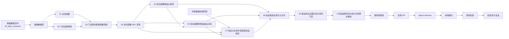

# AI选品V1 链路图导读

## 1. 先看哪些正式图

正式架构图和时序图仍然在 `05_architecture/`，这份文档只是给开发做快速理解。

| 图 | 作用 |
|---|---|
| [完整架构图](../../../05_architecture/diagrams/ai_selection_v1_full_architecture.png) | 看项目分层 |
| [Agent 运行架构图](../../../05_architecture/diagrams/ai_new_product_agent_runtime_architecture.png) | 看 Harness、后端 API 和大模型怎么分工 |
| [运行时序图](../../../05_architecture/diagrams/ai_selection_v1_sequence.png) | 看离线产表和在线查询的先后顺序 |

## 2. 一张总链路图



上面的关键不是箭头多，而是顺序固定。
特别要记住：

```text
04 / 05 / 06 / 07 -> 08 -> 09 -> 10
```

## 3. 离线链路怎么跑

离线部分负责把结果先算好。

```text
基础数据准备
-> 数据合同与质量校验
-> 01、02 先产上游正式表
-> 03 连接画像和门店品类
-> 04～07 产出锚点、价格、篮子和外部证据
-> 08 标准化候选
-> 09 做证据合成和风险门禁
-> 10 生成推荐结果
```

这一步的原则是：能离线算的都离线算。
不能把重计算放到采购查询时再做一遍。

## 4. 在线链路怎么跑

在线部分只做查询、解释和反馈。

```text
采购输入筛选条件或问题
-> Harness 识别意图并抽参数
-> Harness 选择固定 API
-> 后端查推荐结果表和证据表
-> Harness 做轻量重排和结果组装
-> 大模型解释结果
-> 前端展示
-> 采购反馈写回
```

这里最容易误解的一点是：

```text
采购输入的是筛选条件，不是让系统实时重算算法。
```

## 5. 各层产出什么

| 层 | 产出 |
|---|---|
| 数据底座 | 门店、商品、小票、区域、价格、可订可售、外部竞品数据 |
| 算法 01～03 | 画像、门店品类等级、画像贡献 |
| 算法 04～07 | SKU 表现、价格带、购物篮证据、外部证据 |
| 算法 08～09 | 标准候选、证据合成、风险门禁 |
| 算法 10 | 推荐结果、展示摘要、推荐理由 |
| 后端 / Harness | 查询、解释、反馈和日志 |

## 6. 开发读图顺序

建议先看这三个问题：

```text
这个结果从哪来
这一步谁算
这一步谁查
```

只要这三个问题没搞错，整条链路就不会乱。
