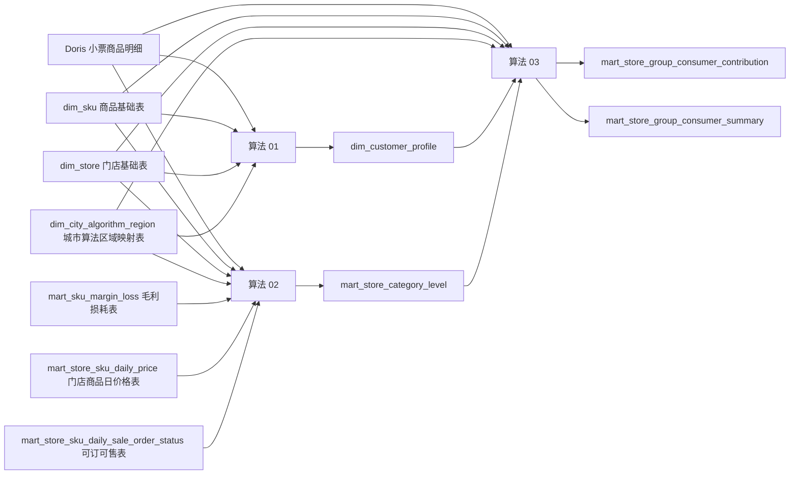

# 算法 01～06 结果表总览

本文给开发快速查看基础数据表和算法 01～06 要产出哪些表、谁依赖谁、哪些本次先评审。

本文主要面向数据开发。后端 API、Agent Harness、大模型解释和反馈日志的运行边界，见：

```text
05_architecture/02_AI新品推荐Agent_运行架构.md
```

## 1. 本次优先级

| 优先级 | 算法 | 处理方式 |
|---|---|---|
| P0 | 基础数据表和公共过滤逻辑 | 本次最先评审，目标是让算法 01～03 有稳定输入 |
| P0 | 01、02、03 | 本次重点评审，目标是让数据开发可以启动 |
| P1 | 04、05、06 | 先阅读，下一轮重点评审 |
| 更新中 | 07、08、09、10 | 文档更新中，不进入本次开发评审 |

## 2. 基础数据表总览

| 表 / 逻辑 | 目标表 | 一行代表什么 | 合同位置 | 本次评审 |
|---|---|---|---|---|
| Doris 小票商品明细 | `data_agent.dws_member_order_item_detail_df_all_new` | 一条小票商品行 | `02_data_contracts/doris_tables/` | 是 |
| 门店基础表 | `dim_store` | 一个门店 | `02_data_contracts/base_tables/dim_store_门店基础表.md` | 是 |
| 商品基础表 | `dim_sku` | 一个销售商品 / SKU | `02_data_contracts/base_tables/dim_sku_商品基础表.md` | 是 |
| 城市算法区域映射表 | `dim_city_algorithm_region` | 一个城市到算法区域的映射 | `02_data_contracts/base_tables/dim_city_algorithm_region_城市算法区域映射表.md` | 是 |
| 毛利损耗表 | `mart_sku_margin_loss` | 一个营业日期 + 门店 + 交易商品 | `02_data_contracts/base_tables/mart_sku_margin_loss_毛利损耗表.md` | 是 |
| 门店商品日价格表 | `mart_store_sku_daily_price` | 一个日期 + 门店 + 销售商品 + 验收商品 | `02_data_contracts/base_tables/mart_store_sku_daily_price_门店商品日价格表.md` | 是 |
| 门店商品每日可订可售表 | `mart_store_sku_daily_sale_order_status` | 一个日期 + 门店 + 销售商品 | `02_data_contracts/base_tables/mart_store_sku_daily_sale_order_status_门店商品每日可订可售表.md` | 是 |
| 有效交易过滤公共逻辑 | 公共 SQL / 过程逻辑 | 过滤退货、退款、负金额、负 `weight` 等异常交易 | `README_开发评审入口.md` 和算法卡公共口径 | 是 |

## 3. 算法正式输出表总览

| 算法 | 算法名称 | 正式表 / 关键表 | 一行代表什么 | 主要上游 | 本次评审 |
|---|---|---|---|---|---|
| 01 | 会员画像 | `dim_customer_profile` | 一个模型版本 + 一个会员的最终画像 | Doris 小票、商品、门店、城市算法区域 | 是 |
| 01 | 会员画像 | `dim_customer_profile_explain` | 一个会员 + 一个画像维度 + 一个指标的解释 | 算法 01 计算过程 | 是 |
| 01 | 会员画像 | `dim_customer_profile_region_param` | 一个区域 + 一个维度 + 一个参数 | 算法 01 参数训练 | 是 |
| 01 | 会员画像 | `mart_customer_profile_summary` | 一个区域 + 一个最终画像的汇总 | `dim_customer_profile` | 是 |
| 02 | 门店品类等级 | `mart_store_category_level` | 一个周期 + 一个范围 + 一个门店 + 一个品类的等级 | 小票、商品、门店、城市区域、毛利损耗、日价格、可订可售 | 是 |
| 02 | 门店品类等级 | 多张参数/解释表 | 指标明细、CRITIC 权重、Jenks/BIC 阈值、健康区间等 | 算法 02 计算过程 | 是 |
| 03 | 门店群消费者画像贡献 | `mart_store_group_consumer_contribution` | 一个范围 + 一个品类 + 一个门店等级群 + 一个消费者画像的贡献 | 算法 01、算法 02、小票、商品、门店、城市区域 | 是 |
| 03 | 门店群消费者画像贡献 | `mart_store_group_consumer_summary` | 一个范围 + 一个品类 + 一个门店等级群的汇总 | `mart_store_group_consumer_contribution` | 是 |
| 04 | 目标画像 SKU 表现 | `mart_sku_repurchase_7d_pre19` | 一个周期 + 一个范围 + 一个画像 + 一个 SKU 的 7 天 19 点前复购结果 | 小票、算法 01、算法 02、算法 03、商品 | 下一轮 |
| 04 | 目标画像 SKU 表现 | `mart_target_profile_sku_performance` | 一个周期 + 一个范围 + 一个门店群 + 一个画像 + 一个销售 SKU 的表现 | 算法 01～03、小票、商品、毛利损耗、日价格、可订可售 | 下一轮 |
| 04 | 目标画像 SKU 表现 | `mart_target_profile_product_performance` | 一个周期 + 一个范围 + 一个门店群 + 一个画像 + 一个标准商品的表现 | `mart_target_profile_sku_performance`、商品 SPU | 下一轮 |
| 04 | 目标画像 SKU 表现 | `mart_target_profile_anchor_summary` | 一个周期 + 一个范围 + 一个门店群 + 一个画像的锚点汇总 | 算法 04 主表 | 下一轮 |
| 04 | 目标画像 SKU 表现 | `mart_target_profile_sku_performance_params` | 一个参数版本 + 一个参数作用范围 + 一个参数 | 算法 04 参数计算 | 下一轮 |
| 05 | 目标画像商品价格带 | `mart_target_profile_price_band` | 一个周期 + 一个范围 + 一个品类 + 一个门店群 + 一个画像 + 一个可比商品组 + 一个规格段的价格带 | 算法 01～04、小票、商品、毛利损耗、日价格、可订可售 | 下一轮 |
| 05 | 目标画像商品价格带 | `mart_product_attribute_price_premium` | 一个周期 + 一个范围 + 一个品类 + 一个可比商品组 + 一个属性值的价格溢价 | 算法 05 属性和价格计算 | 下一轮 |
| 05 | 目标画像商品价格带 | `mart_target_profile_time_discount_curve` | 一个周期 + 一个范围 + 一个品类 + 一个画像 + 一个 SKU/可比组 + 一个折扣档 | 小票折扣代理口径、算法 05 | 下一轮 |
| 05 | 目标画像商品价格带 | `mart_candidate_product_price_feasibility` | 一个价格带 + 一个候选商品 + 一个规格版本 + 一个成本估算版本的价格可行性 | 价格带、候选成本估算、毛利配置 | 下一轮 |
| 05 | 目标画像商品价格带 | `mart_price_band_stability_audit` | 一个价格带 + 一次稳定性验证批次 | 算法 05 稳定性验证 | 下一轮 |
| 05 | 目标画像商品价格带 | `mart_competitor_price_validation_result` | 一个候选商品 + 一个竞对商品 + 一个竞对快照版本的竞对价格验证 | 外部竞品表，07 更新中 | 下一轮 |
| 06 | 目标画像购物篮新品关联 | `mart_basket_profile_scope` | 一个运行批次下的购物篮分析范围 | 算法 01～05、商品、小票 | 下一轮 |
| 06 | 目标画像购物篮新品关联 | `mart_basket_itemset` | 一个范围内的标准商品集合共现结果 | 小票、商品 SPU、可订可售 | 下一轮 |
| 06 | 目标画像购物篮新品关联 | `mart_basket_association_rule` | 一个 A=>B 购物篮关联规则 | 共现结果、自然篮子过滤 | 下一轮 |
| 06 | 目标画像购物篮新品关联 | `mart_basket_rule_validation` | 一个规则 + 一个验证范围的稳定性验证结果 | 算法 06 验证过程 | 下一轮 |
| 06 | 目标画像购物篮新品关联 | `mart_basket_new_product_candidate` | 一个购物篮规则生成的新品候选 | 算法 06、算法 05 价格/规格上下文 | 下一轮 |
| 06 | 目标画像购物篮新品关联 | `mart_basket_algorithm_param` | 一个运行批次 + 一个参数的算法参数 | 算法 06 参数配置 | 下一轮 |

## 4. 01～03 第一批开发依赖



## 5. 本次开发不需要评审到什么程度

| 内容 | 本次处理 |
|---|---|
| 04 的复购表和 SKU 表现 | 先阅读，下一轮确认实现细节 |
| 05 的候选成本、公司毛利配置和价格阶梯 | 先阅读，等待业务/财务/采购补配置 |
| 06 的小分类新品属性规则、季节商品状态 | 先阅读，下一轮确认规则资产 |
| 07～10 | 更新中，不进入本次开发评审 |
