# AI 选品 V1 端到端链路导读

本文融合原链路图导读和当前开发链路说明。它只讲开发主线，不替代字段级数据合同和开发版算法卡。

## 1. 先看哪些正式图

正式架构图和时序图在 `02_architecture/`：

| 图 | 作用 |
|---|---|
| [完整架构图](../02_architecture/diagrams/ai_selection_v1_full_architecture.png) | 看项目分层 |
| [Agent 运行架构图](../02_architecture/diagrams/ai_new_product_agent_runtime_architecture.png) | 看 Harness、后端 API 和大模型怎么分工 |
| [运行时序图](../02_architecture/diagrams/ai_selection_v1_sequence.png) | 看离线产表和在线查询的先后顺序 |

## 2. 一句话原则

```text
离线算法先把结果表算好；
在线查询只读取正式结果表和证据表；
Agent 负责理解问题、调用接口、组织解释，不直接扫描小票实时重算算法。
```

## 3. 总链路图

```mermaid
flowchart LR
    PRODUCT["产品需求<br/>01_product"] --> ARCH["架构与时序<br/>02_architecture"]
    ARCH --> CONTRACT["数据合同<br/>03_data_contracts"]
    CONTRACT --> BASE["基础数据表 / 外部表 / 规则表<br/>Doris 小票 / 商品 / 门店 / 商品状态 / 竞品 / 规则配置"]
    BASE --> FILTER["公共交易过滤和维表关联<br/>有效交易 / 商品关联 / 门店关联 / 城市区域 / 版本血缘"]

    FILTER --> A01["01 会员画像"]
    FILTER --> A02["02 门店品类等级"]
    A01 --> A03["03 门店群消费者画像贡献"]
    A02 --> A03
    A03 --> A04["04 目标画像 SKU 表现"]
    A04 --> A05["05 目标画像商品价格带"]
    A04 --> A06["06 目标画像购物篮新品关联"]
    A04 --> A07["07 竞品与全球外部趋势新品发现"]
    A06 --> A07
    A07 --> A05
    A04 --> A08["08 新品候选标准化与合并"]
    A05 --> A08
    A06 --> A08
    A07 --> A08
    A08 --> A09["09 新品机会证据合成与风险门禁"]
    A09 --> A10["10 新品推荐优先级与开发需求编排"]
    A10 --> API["后端 API"]
    API --> HARNESS["Agent Harness"]
    HARNESS --> FRONT["前端展示"]
    FRONT --> FEEDBACK["采购反馈与复盘"]
```



关键顺序固定：

```text
04 / 05 / 06 / 07 -> 08 -> 09 -> 10
```

## 4. 开发分阶段主线

| 阶段 | 范围 | 处理方式 |
|---|---|---|
| P0 | 基础数据表、外部表、规则表、公共过滤逻辑、版本血缘 | 最先建设，给全部算法提供稳定输入 |
| P1 | 算法 01、02、03 | 产出画像、门店等级和画像贡献 |
| P2 | 算法 04、05 内部价格带、06 | 产出现有 SKU、价格带、候选价格可行性和购物篮内部候选 |
| P3 | 算法 07、算法 05 竞对价格验证 | 产出外部候选、竞品趋势、图片、风险线索和竞对价格验证 |
| P4 | 算法 08、09 | 产出标准候选、范围候选、机会证据和风险门禁 |
| P5 | 算法 10 | 产出推荐列表、详情摘要、解释、范围汇总和审计 |
| P6 | 后端 API / Agent / 前端 | 读取算法 10 表，不实时重算离线算法 |

开发第一步不是直接写算法 01。必须先完成基础数据表、外部表、规则表、公共交易过滤和版本血缘设计，再进入算法结果表建设。

## 5. 离线链路怎么跑

离线部分负责把结果先算好。

```text
基础数据准备
-> 数据合同与质量校验
-> 01、02 先产上游正式表
-> 03 连接画像和门店品类
-> 04～07 产出锚点、价格、篮子和外部证据
-> 08 标准化候选
-> 09 做证据合成和风险门禁
-> 10 生成推荐结果
```

能离线算的都离线算。不能把重计算放到采购查询时再做一遍。

## 6. 在线链路怎么跑

在线部分只做查询、解释和反馈。

```text
采购输入筛选条件或问题
-> Harness 识别意图并抽参数
-> Harness 选择固定 API
-> 后端查推荐结果表和证据表
-> Harness 做轻量重排和结果组装
-> 大模型解释结果
-> 前端展示
-> 采购反馈写回
```

这里最容易误解的一点是：

```text
采购输入的是筛选条件，不是让系统实时重算算法。
```

## 7. 05 和 07 的关系

算法 05 不是单纯获取竞对商品价格。它的职责有两层：

1. 先基于内部交易、价格、毛利、价格点规则和候选成本，计算目标画像商品价格带、候选建议价、成本上限和价格可行性。
2. 在算法 07 产出可比竞对对象和外部价格证据后，读取 `fact_competitor_sku_daily_snapshot` 等外部快照，补齐竞对价格验证结果。

因此：

```text
05 内部价格带不依赖 07，可以先产出。
05 竞对价格验证依赖 07，属于 07 完成后的补充验证表。
08 读取 05 的价格可行性、06 的购物篮候选、07 的外部候选和竞对趋势证据。
```

## 8. 开发要去哪里看

| 开发要做什么 | 先看哪个文件 / 目录 |
|---|---|
| 确认 Doris 小票字段 | `03_data_contracts/doris_tables/` |
| 准备内部基础表 | `03_data_contracts/base_tables/` |
| 准备外部竞品表 | `03_data_contracts/external_data/` |
| 准备规则配置表 | `03_data_contracts/rule_tables/` |
| 查看算法和结果表总览 | `00_start_here/03_算法与结果表总览.md` |
| 开发具体算法 | `04_algorithm_cards/developer_version/` |
| 做后端 / Agent 联调 | `04_algorithm_cards/developer_version/算法卡_10_新品推荐优先级与开发需求编排.md` 和 `02_architecture/` |

## 9. 在线查询读取什么

后端和 Agent 默认不读取上游 01～09 表直接拼推荐列表。推荐列表以算法 10 表为入口：

| 使用场景 | 读取表 |
|---|---|
| 推荐列表 | `mart_new_product_recommendation_priority` + `new_product_recommendation_display_brief` |
| 推荐详情 | `new_product_recommendation_display_brief` + `new_product_recommendation_explanation` |
| 推荐解释和追溯 | `new_product_recommendation_input_snapshot` + `new_product_recommendation_evidence_dimension` + 09 证据表 |
| 批次状态 | `new_product_recommendation_run` |
| 异常排查 | `new_product_recommendation_audit` |

上游算法表主要用于离线计算、对数验收、证据追溯和按推荐 ID 展开证据，不作为推荐列表主入口。

## 10. 开发读图方法

每看到一个节点，只问三个问题：

```text
这个结果从哪来
这一步谁算
这一步谁查
```

这三个问题不搞错，整条链路就不会乱。
