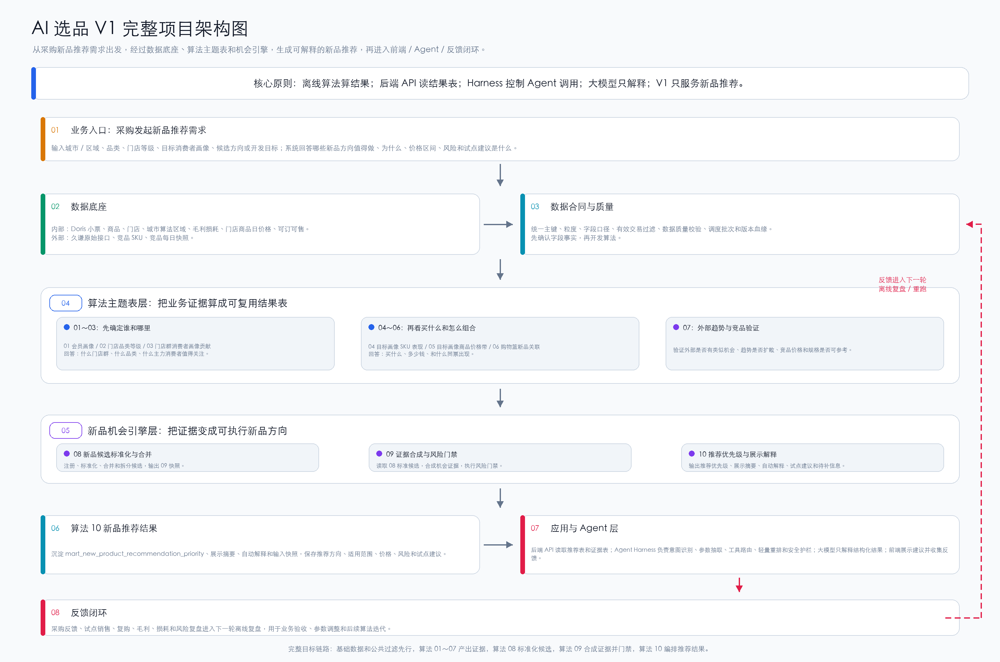

# AI 选品 V1 整体架构

本文给开发介绍 AI 选品 V1 的完整项目架构：从采购提出新品推荐需求，到数据底座、算法主题表、新品机会引擎、推荐结果表、后端 / Agent / 前端使用，以及采购反馈闭环。

## 1. 这个项目是干什么的

AI 选品 V1 的目标是：

```text
围绕采购新品开发决策，
用内部交易经营数据和外部竞品趋势数据，
生成可解释、可追溯、可评审的新品机会推荐。
```

它不是：

```text
不是让大模型直接扫小票实时算算法。
不是做门店自动订货。
不是做独立毛利分析产品。
不是做购物篮提升产品。
```

它要回答的是：

```text
什么城市 / 区域？
什么品类？
什么门店群？
什么主力消费者画像？
这些消费者真实偏好什么商品共性？
外部竞品和趋势是否支持？
最终哪些新品方向值得开发，价格和风险是什么？
```

## 2. 当前整体架构图



## 3. 完整流程怎么理解

| 层级 | 说明 |
|---|---|
| 业务入口层 | 采购输入城市、品类、门店等级、目标画像或候选方向，发起新品推荐查询 |
| 数据底座层 | Doris 小票、商品、门店、城市算法区域、毛利损耗、价格、可订可售、外部竞品数据 |
| 数据合同与质量层 | 确认字段口径、主键粒度、有效交易过滤、版本血缘和数据质量 |
| 算法主题表层 | 01～07 产出会员画像、门店等级、画像贡献、SKU 表现、价格带、购物篮、外部趋势等证据 |
| 新品机会引擎层 | 08 做新品候选标准化与合并，09 做新品机会证据合成与风险门禁，10 做推荐优先级、展示摘要和解释 |
| 推荐结果层 | 沉淀算法 10 推荐结果表，保存推荐方向、证据、价格、风险、适用门店群、展示摘要、解释和试点建议 |
| 应用与 Agent 层 | 后端 API 读取推荐表和证据表；Agent Harness 负责意图识别、参数抽取、工具路由、轻量重排和安全护栏；大模型只解释结构化结果；前端展示建议并收集反馈 |
| 反馈闭环层 | 采购反馈、试点结果、销售表现和风险复盘回流，用于后续验收和迭代 |

## 4. Agent 运行边界

V1 采用：

```text
工作流型 Agent + 工具调用型 Harness
```

开发理解重点：

```text
1. 大计算离线完成：算法任务定时读取基础表和主题表，写入推荐结果表。
2. API 是唯一入口：后端 API 读取 `mart_new_product_recommendation_priority`、`new_product_recommendation_display_brief`、`new_product_recommendation_explanation` 和证据表。
3. Harness 控制调用：负责识别采购问题、抽取参数、选择工具、轻量重排和安全护栏。
4. 大模型只做解释：不直接扫描小票明细，不实时重算算法。
5. 采购反馈回流：先进入日志和反馈表，用于下一轮离线复盘和参数校准。
```

更细的后端 API、Harness、工具调用和反馈链路，见 [02_AI新品推荐Agent_运行架构.md](02_AI新品推荐Agent_运行架构.md)。

## 5. 图文边界

本目录的架构图和架构说明只描述完整目标链路：

```text
不表达算法卡整理进度。
不表达本次开发评审优先级。
不替代开发排期和交付状态。
```

当前开发评审范围、算法卡整理进度和未决事项，以根目录 [README_开发评审入口.md](../README_开发评审入口.md) 和 `00_project_management/development_review/` 为准。

## 6. 开发评审入口

继续阅读：

```text
05_architecture/02_AI新品推荐Agent_运行架构.md
05_architecture/03_AI选品V1_运行时序.md
README_开发评审入口.md
00_project_management/development_review/AI选品V1_当前开发链路.md
00_project_management/development_review/算法01-10_结果表总览.md
00_project_management/development_review/AI选品V1_开发评审问题清单.md
```
