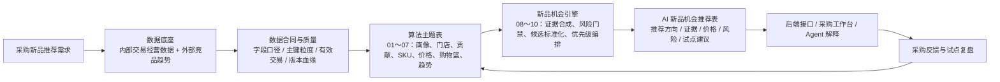

# 架构资料

这里存放 AI 选品项目的数据流、算法流、机会引擎运行方式、Agent 调用链路和相关架构图。

## 推荐阅读

第一次进入项目时，建议先从根目录 `README.md` 建立背景，再看本目录两张图：

```text
README.md
05_architecture/AI选品V1_完整架构图.md
05_architecture/AI选品V1_运行时序图.md
```

当前架构图图片：


当前运行时序图图片：


## 当前 V1 完整链路

当前架构从采购新品推荐需求开始，到数据底座、算法主题表、新品机会引擎、推荐结果表、后端 / Agent / 前端应用和反馈闭环。



## 当前评审入口

开发评审优先阅读：

```text
README_开发评审入口.md
00_project_management/development_review/AI选品V1_当前开发链路.md
02_data_contracts/
00_project_management/development_review/算法01-06_结果表总览.md
```
