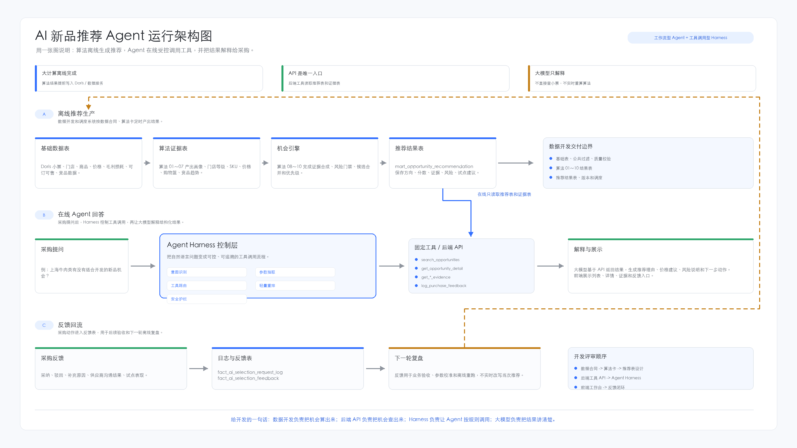
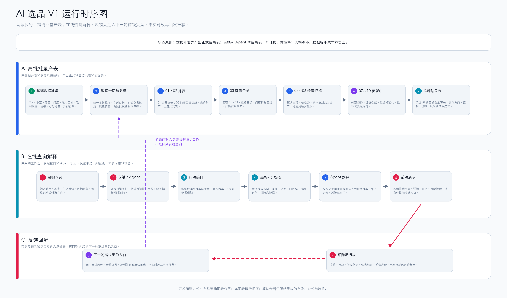

# AI 智能选品项目

本仓库用于沉淀 AI 新品推荐项目中可以协作、评审和开发落地的确定性材料。

当前 V1 目标是：围绕采购新品推荐场景，基于 Doris 基础数据、业务算法规则、外部竞品数据和机会评分逻辑，形成可被采购使用的 AI 选品能力。

## 入口

本仓库只保留一个完整开发评审阅读顺序：

```text
README_开发评审入口.md
```

其他 README 只说明各自目录放什么，不再重复维护完整阅读顺序。

| 角色 | 建议入口 | 用途 |
|---|---|---|
| 开发评审 | [README_开发评审入口.md](README_开发评审入口.md) | 唯一完整阅读顺序、评审范围、预审 Prompt 和会议方式 |
| 快速导读 | [00_project_management/development_review/quick_read/README.md](00_project_management/development_review/quick_read/README.md) | 给第一次进入项目的人快速看懂项目目标、链路、调度和 01～10 算法 |
| 架构理解 | [05_architecture/](05_architecture/README.md) | 完整架构图、Agent 运行架构图、运行时序图 |
| 数据开发 | [02_data_contracts/](02_data_contracts/README.md) | 基础表、外部表、Doris 表和规则配置表字段合同 |
| 外部采集 | [02_data_contracts/external_data/外部数据采集模块_开发说明.md](02_data_contracts/external_data/外部数据采集模块_开发说明.md) | 说明外部 API、HTTP 采集、无头浏览器和 browser-harness 的生产边界 |
| 规则落表 | [02_data_contracts/rule_tables/业务规则Excel落表模块_开发说明.md](02_data_contracts/rule_tables/业务规则Excel落表模块_开发说明.md) | 说明业务 Excel 如何校验、转 CSV、落 Doris、发布规则版本 |
| 算法落地 | [03_algorithm_cards/developer_version/](03_algorithm_cards/developer_version/) | 开发版算法卡，按表、字段、公式、调度和验收落地 |
| 产品 / Agent | [04_product/](04_product/README.md) | 后续沉淀工作台、对话入口和 Agent 产品形态 |

开发首步不是直接从算法 01 开始。数据开发需要先确认并准备基础数据表、外部表、规则表和公共过滤逻辑：

```text
Doris 小票商品明细
dim_store 门店基础表
dim_sku 商品基础表
dim_city_algorithm_region 城市算法区域映射表
mart_sku_margin_loss 毛利损耗表
mart_store_sku_daily_price 门店商品日价格表
mart_store_sku_daily_sale_order_status 门店商品每日可订可售表
dim_product_status 商品状态表
```

当前 V1 完整架构图：


当前 AI 新品推荐 Agent 运行架构图：



当前 V1 运行时序图：



开发理解重点：

```text
数据开发先准备基础数据表和公共过滤逻辑，再产出正式算法结果表；
后端 API 读取推荐表和证据表；
Agent Harness 负责意图识别、参数抽取、工具路由、轻量重排和安全护栏；
大模型只解释结构化结果，不直接扫描小票实时计算算法。
```

## 仓库边界

放入 Git 的内容：

- 项目计划、待办、业务确认材料
- 业务原始算法规则的 Markdown 溯源材料
- 基础表、外部表、Doris 表和规则配置表的数据合同
- 给数据开发使用的算法卡
- 给业务和产品理解使用的业务解读版
- 架构图、时序图、运行流程图
- 可复用脚本
- 脱敏或人造样例数据

不放入 Git 的内容：

- 真实 Excel 业务导出
- 真实 CSV 明细或分析结果
- Doris 查询结果明细
- 久谦 API 原始返回数据
- PDF 原始资料
- 临时截图和运行输出
- Python 依赖包和缓存

## Git 目录说明

| 目录 / 文件 | 给谁看 | 用途 |
|---|---|---|
| `README.md` | 全体 | 仓库总入口，说明项目目标、目录边界和开发快速入口 |
| `README_开发评审入口.md` | 开发 / 产品 / 项目侧 | SDD 开发评审入口，说明读文档顺序和评审方式 |
| `AGENTS.md` | Codex | 文档整理和算法卡复核规则，开发可以忽略 |
| `00_project_management/` | 产品 / 项目侧 / 开发评审 | 项目计划、业务确认、开发评审资料 |
| `00_project_management/development_review/` | 开发 / 产品 / 项目侧 | SDD 评审包：开发链路、结果表总览、评审问题清单 |
| `00_project_management/development_review/quick_read/` | 开发 / 产品 / 项目侧 | 快速导读包：项目导读、链路图导读和算法 01～10 导读 |
| `00_project_management/business_confirmations/` | 产品 / 业务 / 项目侧 | 业务确认材料入口，按用途拆分为待确认、审阅、溯源和交付核对 |
| `00_project_management/business_confirmations/pending_items/` | 业务 / 产品 / 项目侧 | 需要业务集中补充或确认的事项，优先给业务看 |
| `00_project_management/business_confirmations/review_checklists/` | 你 / 项目侧复核人 | 算法审阅清单和红线问题，内部复核用 |
| `00_project_management/business_confirmations/source_traceability/` | 你 / 项目侧复核人 | 业务原文承接矩阵，证明业务原文没有漏掉、删掉或改写 |
| `00_project_management/business_confirmations/delivery_checks/` | 项目侧 / Codex | 输出前逐项核对和交付前复核结论，避免旧结论误导 |
| `01_source_docs/` | 产品 / 算法 / 需要溯源的人 | 业务原始与补充算法文档，只做溯源，不让开发自行猜口径 |
| `02_data_contracts/` | 数据开发 | 基础表、外部表、Doris 表和规则配置表字段合同；开发首步必须先看 |
| `02_data_contracts/external_data/` | 数据开发 / 外部采集开发 | 外部竞品数据合同和外部数据采集模块说明 |
| `02_data_contracts/rule_tables/` | 数据开发 / 产品 / 业务规则维护方 | 规则配置表合同、标准 Excel 清单和 Excel 落表模块说明 |
| `03_algorithm_cards/developer_version/` | 数据开发 | 开发版算法卡，按表、字段、公式、调度和验收落地 |
| `03_algorithm_cards/business_readable/` | 业务 / 产品 / 采购 / 开发评审 | 业务解读版，帮助理解算法目的和业务含义 |
| `04_product/` | 产品 / 前后端 / Agent | 产品需求、业务流程、原型资料 |
| `05_architecture/` | 开发 / 产品 / 项目侧 | 完整架构图、运行时序图、运行设计 |
| `06_scripts/` | 开发 / Codex | 可复用脚本，例如架构图生成脚本 |
| `07_examples/` | 开发 / 测试 | 脱敏或人造样例数据 |
| `local_only/` | 本地个人使用 | 真实业务数据、临时验证结果，不进入 Git |

说明：真实业务数据、本地导出文件和临时验证结果可以放在本机 `local_only/` 目录，但该目录不进入 Git。

当前规则标准导入包如需本地暂存，放在 `02_data_contracts/rule_tables/import_ready/` 或 `local_only/`；该目录内容不进入正式 Git，开发优先使用标准 CSV 落 Doris。

## 当前项目原则

1. 业务原始文档只做溯源，不直接改写。
2. 每个算法卡独立成文档，最终面向数据开发落地。
3. 算法卡需要同时具备业务可理解性和开发可执行性。
4. V1 暂不纳入供应商基础表、库存损耗明细表、促销优惠券明细表。
5. V1 聚焦新品推荐，不做毛利分析和购物篮提升产品能力。
